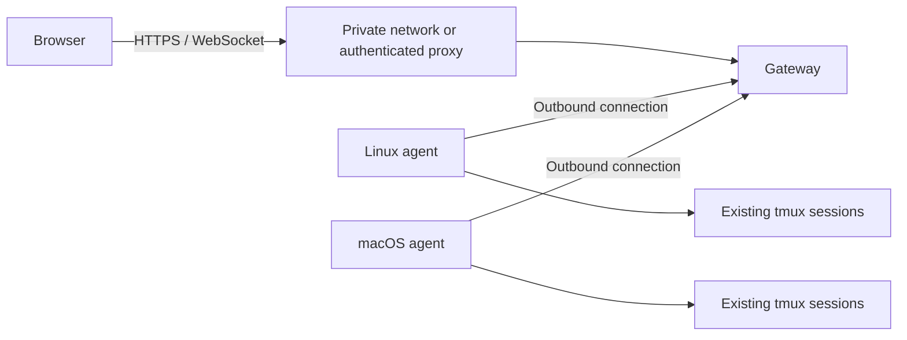

# Tmux Bridge

[](https://github.com/ar-ramchandra/tmux-bridge/actions/workflows/tests.yml)

A self-hosted browser gateway for existing tmux sessions across your Linux and macOS machines.

Each machine runs an agent that connects outward to your gateway. Open the browser, choose a machine and session, and continue the same work from another device. Closing a browser tab leaves the tmux session running.

**Status: early alpha.** Intended for an individual or a small group of equally trusted operators. Browser access grants shell access; there are no per-user roles or tenant boundaries. Keep the gateway on loopback and use a restricted private network or an authenticating reverse proxy for remote access. See [security](SECURITY.md) before exposing anything.

## Features

- One session picker for multiple machines, with reconnecting agents.
- Persistent terminal tabs, session history search, and explicit take/release input control.
- Direct text selection, clipboard shortcuts, clickable HTTP(S) terminal links, and touch controls.
- tmux sessions survive browser disconnects; the gateway does not replace tmux.
- One-time node enrollment with signed application credentials.
- Optional private-CA mTLS transport and per-node Cloudflare installer bundles for an explicitly configured deployment.
- Linux and macOS support; no Windows agent in this release.

## Try it locally

Install Python 3.10+ and tmux first. Python 3.12 or newer is recommended.

```sh
git clone https://github.com/ar-ramchandra/tmux-bridge.git
cd tmux-bridge
./setup.sh
. .venv/bin/activate
tmux-bridge init
tmux-bridge gateway
```

The gateway listens at `http://127.0.0.1:4601`. In a second terminal, from the same checkout:

```sh
. .venv/bin/activate
tmux-bridge add-server laptop
```

Copy the one-time code it prints. Then enroll the agent:

```sh
tmux-bridge pair --gateway http://127.0.0.1:4601
# Paste the code at the prompt.
tmux new-session -d -s bridge-demo
tmux-bridge agent
```

Open `http://127.0.0.1:4601` and select `laptop` → `bridge-demo`. Run the agent as the account that owns the tmux sessions. The commands run in the foreground; leave their terminals open. If you already have agent credentials, use `--agent-dir` to select a separate private directory rather than replacing them.

Use `tmux-bridge doctor` to check prerequisites. Nothing automatically opens a firewall, publishes a public tunnel, or changes a mesh VPN.

## Connect another machine

Install this project on that machine and use the same `add-server` / `pair` flow. Pairing accepts HTTPS for remote addresses and HTTP only for loopback. An SSH forward is a useful first setup; private HTTPS is another option. See [installation and remote access](docs/setup.md).

The optional `./add-node.sh NAME` creates a private installer ZIP for an **already configured Cloudflare/mTLS deployment**. It is not a one-command Cloudflare gateway bootstrap. See [node installers](docs/add-nodes.md) and [transport configuration](docs/cloudflare.md).

## Terminal controls

Drag to select text; double-click to select a word. Copy with Command+C or Ctrl+C while a selection exists. Ctrl+C without a selection still interrupts the program. Alt/Option-click forwards mouse input to a terminal application. Web links open directly; dragging across a link selects text.

Wheel/trackpad scrolling uses terminal history or real mouse reports, rather than synthesizing Up/Down keys. The existing History control provides a searchable text snapshot, including on touch devices. Clipboard availability depends on the browser and secure context. See [usage](docs/usage.md).

## Architecture



The gateway can read terminal traffic and control connected agents. In the optional mTLS design, our private TLS session protects the **agent-to-gateway leg** through the carrier. It does not make the browser-to-gateway session end-to-end encrypted against its HTTPS proxy. [Architecture and trust boundaries](docs/architecture.md).

## Release limits

- Certificate renewal is manual. Application credentials last one year; installer transport certificates last 90 days.
- No independent security audit, per-user authorization, or command audit trail.
- Physical mobile keyboards, selection handles, and clipboard permission prompts need more device testing.
- Automated browser tests exercise Chromium and WebKit; they do not certify every browser/device combination.
- Cloudflare provisioning depends on its management API and the operator's preconfigured Access policies.
- xterm.js assets load from pinned CDN URLs; an Internet connection is required for the browser frontend.

[Testing and development](CONTRIBUTING.md) · [Validation record](docs/validation.md) · [Roadmap](docs/roadmap.md) · [Changelog](CHANGELOG.md)

## Related projects

[ttyd](https://github.com/tsl0922/ttyd) provides browser terminals; [Hearth](https://github.com/fzlzjerry/hearth) manages tmux across SSH servers; [muxdeck](https://github.com/josecarlosrivas/muxdeck) provides browser access beside a tmux server; [Guacamole](https://guacamole.apache.org/) covers broader remote access. Tmux Bridge focuses on a central gateway with outbound agents and existing tmux sessions. See their documentation when comparing deployment models.

## License

MIT. See [LICENSE](LICENSE) and [third-party acknowledgments](THIRD_PARTY.md).
## Prompt status and notifications

Provider hooks can show prompt status in the session list, notify browsers and
phones, and expose read-only completion events to connected agents through MCP.
See [setup and notification settings](docs/activity.md). You retain direct control
of each terminal; response completion does not imply the whole goal is verified.
